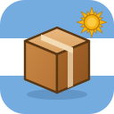
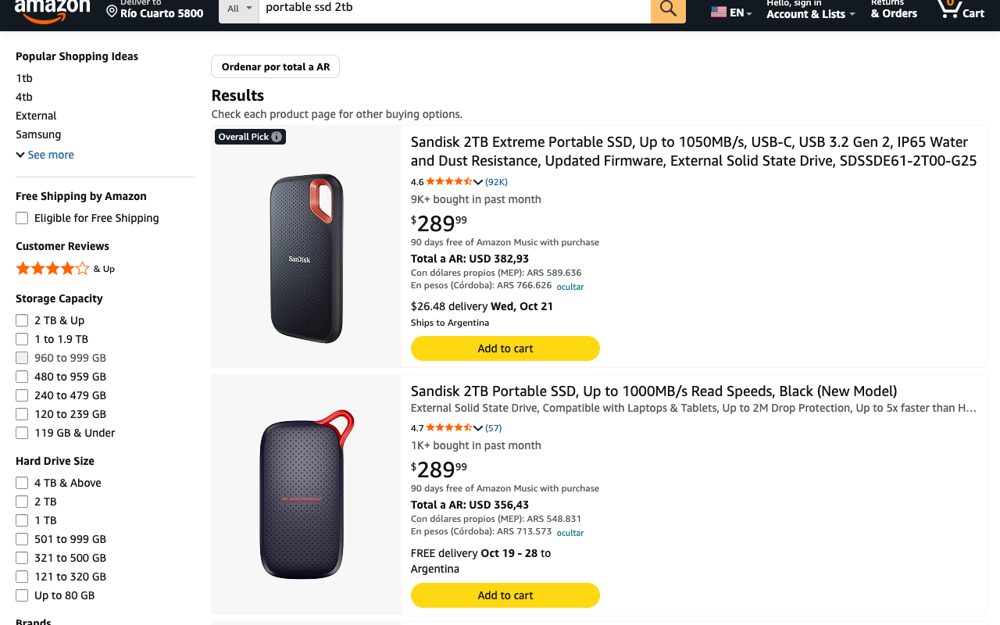
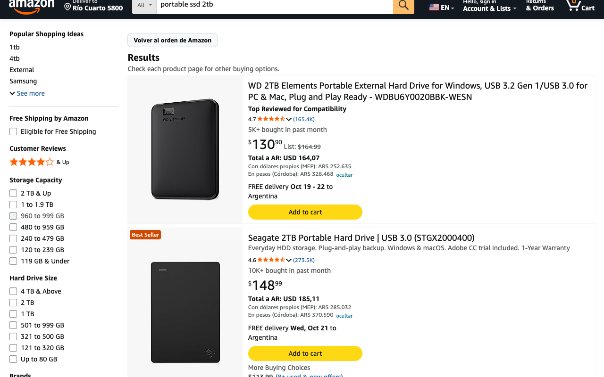
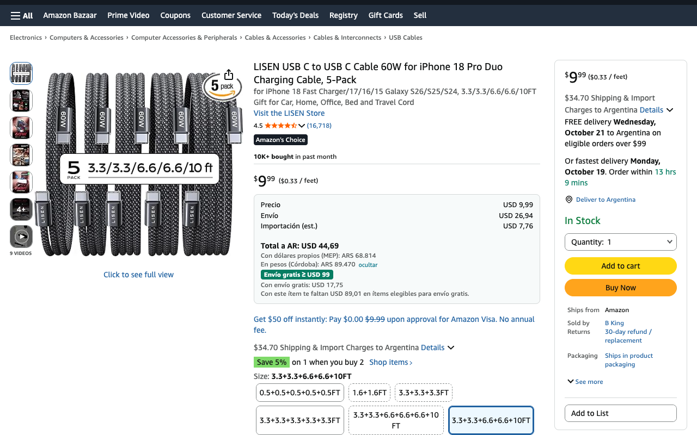

<p align="center"></p>

# Amazoncito

Extensión para Chrome, Arc, Brave, Edge, Firefox y Zen que te muestra en **amazon.com** cuánto te cuesta
de verdad traer cada producto a Argentina, sin tener que abrirlo uno por uno.



## Qué hace

- **Total a Argentina** en cada producto (búsquedas, más vendidos, ofertas y la ficha): precio +
  envío AmazonGlobal + cargos de importación estimados por Amazon.
- **En pesos**, de dos formas: pagando con dólares propios (MEP) y pagando en pesos con
  percepciones (Ganancias 30 % + Ingresos Brutos de tu provincia).
- **Envío gratis desde USD 99**: etiqueta verde en los productos elegibles y cuánto costarían con
  ese envío.
- **Ordenar por total**: botón arriba de los resultados. El más barato en Amazon no siempre es el
  más barato puesto en Argentina.
- **Productos que no envían a Argentina**: se atenúan (o se ocultan, desde Opciones).
- **Avisos del régimen courier**: si superás la franquicia de USD 400 o el tope de USD 3.000 por envío.
- **Carrito**: cuánto te falta para el envío gratis y el total estimado del pedido.
- Funciona con Amazon en **dólares o en pesos**.

| Ordenado por total | Ficha del producto |
|---|---|
|  |  |

## Instalación

### Chrome, Arc, Brave y Edge

1. **Descargá** [amazoncito.zip](https://github.com/Gremiger/amazoncito/releases/latest/download/amazoncito.zip).
2. **Descomprimilo** en una carpeta que no vayas a borrar (por ejemplo, `Documentos/amazoncito`).
   ⚠️ El navegador la usa desde ahí: si la borrás o la movés, la extensión deja de funcionar.
3. **Abrí la página de extensiones** de tu navegador:
   - Chrome: `chrome://extensions`
   - Arc: `arc://extensions`
   - Brave: `brave://extensions`
   - Edge: `edge://extensions`
4. **Activá el "Modo de desarrollador"** (Developer mode), arriba a la derecha (en Edge, abajo a
   la izquierda).
5. Tocá **"Cargar descomprimida"** (Load unpacked) y elegí la carpeta del paso 2 (la que tiene
   el archivo `manifest.json` adentro).
6. Entrá a [amazon.com](https://www.amazon.com) con la **ubicación de entrega en Argentina**
   (arriba a la izquierda, "Deliver to"). Listo.

> El navegador puede mostrar un aviso sobre extensiones en modo desarrollador: es normal en las
> extensiones que no vienen de la tienda.

### Firefox y Zen

1. Abrí [amazoncito.xpi](https://github.com/Gremiger/amazoncito/releases/latest/download/amazoncito.xpi)
   desde Firefox o Zen y aceptá la instalación. Si se descarga en vez de instalarse, arrastrá el
   archivo a una ventana del navegador.
2. Si se abren las Opciones con el aviso **"necesita acceso a amazon.com"**, tocá **"Dar acceso"**.
3. Entrá a [amazon.com](https://www.amazon.com) con la **ubicación de entrega en Argentina**.

La extensión está firmada por Mozilla, así que queda instalada de forma permanente.

## Configuración

Desde la página de extensiones → Amazoncito → **Detalles** → **Opciones de la extensión**:

- **Percepción IIBB**: viene en 0 % (Córdoba). Si sos de otra provincia, poné la que ves en el
  resumen de tu tarjeta.
- **Perfil**: el nombre que aparece en la línea "En pesos (…)".
- Mostrar u ocultar los pesos, qué hacer con los productos que no envían, y más.

## Actualizar

Cuando haya una versión nueva:

1. Descargá de nuevo [amazoncito.zip](https://github.com/Gremiger/amazoncito/releases/latest/download/amazoncito.zip).
2. Reemplazá el contenido de tu carpeta con el del zip nuevo.
3. En la página de extensiones, tocá el ícono de recargar (↻) de Amazoncito.

En Firefox y Zen alcanza con abrir de nuevo [amazoncito.xpi](https://github.com/Gremiger/amazoncito/releases/latest/download/amazoncito.xpi)
y aceptar: se instala encima de la anterior, sin perder la configuración.

Las versiones y sus cambios están en [Releases](https://github.com/Gremiger/amazoncito/releases).

## Si algo no anda

- **No aparece nada**: revisá que la ubicación de entrega de Amazon sea Argentina y recargá la página.
- **"Amazon pidió captcha"**: resolvé el captcha en cualquier página de Amazon. Si se repite,
  en Opciones → Listados elegí "Solo al pasar el mouse".
- **"Cambiá la moneda de Amazon a USD o ARS"**: Amazon está en otra moneda (euros, reales…).

## Privacidad

No hay servidores, cuentas ni analíticas: todo queda en tu navegador. Ver la
[política de privacidad](store/privacy-policy.md).

Los montos son estimaciones basadas en lo que informa Amazon; el valor final lo define Amazon en
el checkout y tu banco en el resumen.

Amazoncito no está afiliado a Amazon.com, Inc.

## Licencia

[MIT](LICENSE): podés usarla, modificarla y compartirla libremente, manteniendo el aviso de autoría.

## Desarrollo

```sh
npm install
npm test          # tests con node --test y fixtures reales de Amazon
npm run pack      # arma dist/amazoncito-<versión>.zip
npm run pack:firefox  # arma dist/amazoncito-firefox-<versión>.zip para firmar en AMO
```

Para Firefox: `npx web-ext lint` valida la extensión y `npx web-ext run` la abre en un Firefox
limpio.

Para publicar una versión nueva:

1. Subir `version` en `manifest.json` (Mozilla no acepta dos veces la misma).
2. `npm run pack` y `npm run pack:firefox`.
3. Subir el zip de Firefox en [addons.mozilla.org](https://addons.mozilla.org/developers/addon/3092086/versions)
   como "unlisted" y bajar el `.xpi` firmado.
4. Crear el release con `amazoncito.zip` y `amazoncito.xpi` (con esos nombres, así los links de
   descarga siempre apuntan al último).
